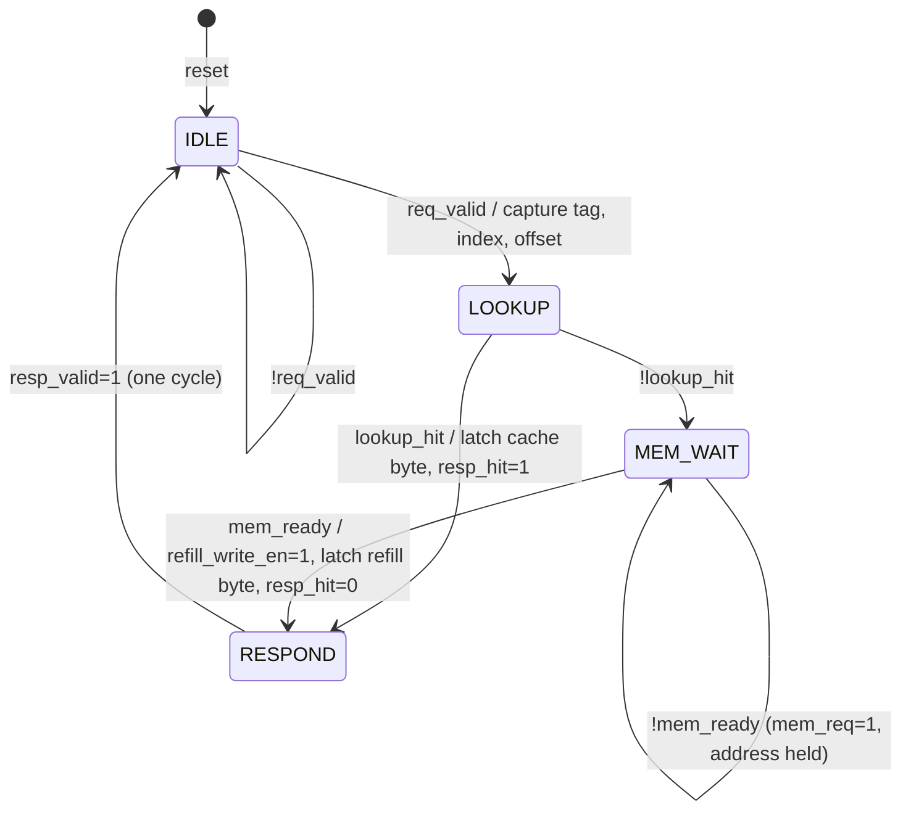

# Cache Controller FSM Design

Owner: **Member 04 - Cache Controller FSM and Main-Memory Model**
RTL: `rtl/cache_controller.v` · Test: `tb/tb_cache_controller.v` · Run: `./scripts/run_cache_controller_test.sh`

## 1. What the controller does

The controller is the cache's traffic manager. It accepts one read request at a time, holds the request's tag/index/offset stable, checks the lookup result, and then does one of two things:

- **Hit:** return the byte already in the cache. Main memory is never asked.
- **Miss:** ask main memory for the aligned 16-byte block and wait until memory says it is ready. Install the block, tag and valid bit into the selected line, then return the requested byte.

Main memory does not respond immediately, so a miss takes several steps. Each step is one FSM state.

## 2. State diagram



```text
            req_valid                lookup_hit
   +------+ ---------> +--------+ ---------------------------+
   | IDLE |            | LOOKUP |                            v
   +------+ <-+        +--------+                       +---------+
      ^       |            | !lookup_hit                | RESPOND |
      |       |            v                            +---------+
      |       |       +----------+  mem_ready / refill       |
      |       |       | MEM_WAIT | --------------------------+
      |       |       +----------+                           |
      |       |        ^      | !mem_ready                   |
      |       |        +------+                              |
      |       +----------------------------------------------+
      +-- reset (from any state)
```

## 3. State table

| State | Encoding | Moore outputs | Condition | Next state | Registered action on the edge |
|---|---|---|---|---|---|
| `IDLE` | `2'd0` | `req_ready=1` | `req_valid` | `LOOKUP` | `active_tag/index/offset <= req_*` |
| | | | `!req_valid` | `IDLE` | — |
| `LOOKUP` | `2'd1` | — | `lookup_hit` | `RESPOND` | `resp_data <= cache_byte_data`, `resp_hit <= 1` |
| | | | `!lookup_hit` | `MEM_WAIT` | — |
| `MEM_WAIT` | `2'd2` | `mem_req=1` | `mem_ready` | `RESPOND` | `refill_write_en=1` installs data/tag/valid; `resp_data <= refill_byte_data`, `resp_hit <= 0` |
| | | | `!mem_ready` | `MEM_WAIT` | — |
| `RESPOND` | `2'd3` | `resp_valid=1` | always | `IDLE` | — |
| any | | | `reset` | `IDLE` | all registers cleared |

`refill_write_en` is the only Mealy output: `(state == MEM_WAIT) && mem_ready`. It can therefore never be high before memory reports the block valid. It is high for exactly one cycle, because the FSM leaves `MEM_WAIT` on that edge.

## 4. Why each rule in the contract holds

| Requirement (PDF 3.4 / `docs/interface_contract.md`) | How the RTL guarantees it |
|---|---|
| Hit completes without a memory request | `mem_req` is decoded only from `MEM_WAIT`, and `LOOKUP` goes straight to `RESPOND` on a hit |
| Memory request uses the aligned block address | `cache_top` drives `mem_addr = {active_tag, active_index, 4'b0000}` |
| Address stable while `mem_req` is active | `active_*` are written only in `IDLE`, and `mem_req` is only high in `MEM_WAIT` |
| No refill before `mem_ready` | `refill_write_en = (state == MEM_WAIT) && mem_ready` |
| Block/tag/valid written into the selected line | One `refill_write_en` pulse drives the write enables of all three RAMs at `active_index` |
| Requested byte returned after refill | `refill_byte_data` is selected from `mem_block` by `active_offset` and latched on the refill edge |
| One response per accepted request | `RESPOND` lasts one cycle; `req_ready` is high only in `IDLE` |
| Reset returns to initial state | Synchronous reset forces `IDLE` from any state |

## 5. Timing

Edge E0 is the rising edge that accepts the request. The memory latency is `LATENCY` (default 4, see `docs/memory_model.md`).

| Case | Edge sequence | `resp_valid` cycle after E0 |
|---|---|---|
| Hit | E0 IDLE→LOOKUP, E1 LOOKUP→RESPOND | **2 cycles** |
| Miss | E1 LOOKUP→MEM_WAIT, E2 memory accepts `mem_req`, E2+LATENCY `mem_ready` pulse, E3+LATENCY refill edge→RESPOND | **LATENCY + 4 cycles** (8 with the default) |

**Miss penalty over a hit = LATENCY + 2 cycles** (6 cycles with the default). Member 05 should use these measured values for AMAT.

Miss sequence with the default latency:

```text
cycle after edge : E0     E1        E2..E5    E6        E7       E8
state            : LOOKUP MEM_WAIT  MEM_WAIT  MEM_WAIT  RESPOND  IDLE
mem_req          : 0      1         1         1         0        0
mem_ready        : 0      0         0         1         0        0
refill_write_en  : 0      0         0         1         0        0
resp_valid       : 0      0         0         0         1        0
```

## 6. Verification evidence

`./scripts/run_cache_controller_test.sh` compiles the complete `cache_top`, with every member's real RTL and no stubs, and runs `tb/tb_cache_controller.v`.

- Log: `results/logs/cache_controller_final.log` (40/40 checks pass)
- Rendered figures: `results/waveforms/cache_controller_miss_hit.png` and `submission/report/figures/controller_{fsm,waveform}.pdf` (regenerate with `python3 scripts/plot_controller_figures.py`)
- Waveform: `results/waveforms/cache_controller_final.vcd`. Test T2 (0x00000004 cold miss) shows the full miss → `mem_req` → wait → `mem_ready`/refill → `resp_valid` sequence. T3 shows the following hit.

| Test | What it proves |
|---|---|
| T1 | Reset during idle → `IDLE`, `req_ready=1`, all valid bits 0 |
| T2 | Cold miss: aligned `mem_addr`, waits for `mem_ready`, writes block/tag/valid to line 0 only, returns correct byte |
| T3 | Repeat of the same address hits in 2 cycles with no memory request and no refill |
| T4 | Different offset in the same block hits with the correct byte |
| T5 | Same index, different tag (0x404) misses and replaces line 0 |
| T6 | The evicted address (0x004) misses again |
| T7 | Lines 0 and 1 stay resident together |
| T8 | Reset during `MEM_WAIT` cancels the memory request; no stale `mem_ready`, refill or response follows |
| T9 | `req_valid` held high: exactly one response per accepted request |

Continuous monitors check every cycle that `refill_write_en ⇒ mem_ready`, that `mem_addr` is stable and aligned while `mem_req` is high, that `resp_valid` is a single-cycle pulse, and that `req_ready` is high only in `IDLE`.

The test was also run against two deliberately broken controllers. One refilled without waiting for `mem_ready`; the other asserted `mem_req` during lookup. The testbench reported failures for both.
