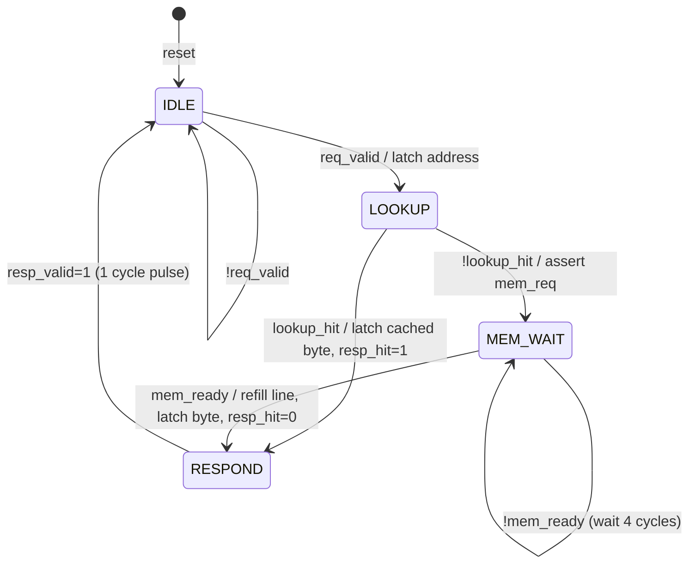

# Circuit Switchers: Complete Conceptual Guide & Viva Preparation Handbook
**Modern Computer Architecture (MCA) — Project 6: Direct-Mapped Cache Controller**

---

## Table of Contents
1. [Introduction: The Core Problem and Why Caches Exist](#1-introduction-the-core-problem-and-why-caches-exist)
2. [The Secret Sauce: Locality of Reference](#2-the-secret-sauce-locality-of-reference)
3. [The Architecture Blueprint & Exact Bit-Arithmetic](#3-the-architecture-blueprint--exact-bit-arithmetic)
4. [Why Direct-Mapped? The Assigned Parking Lot Analogy](#4-why-direct-mapped-the-assigned-parking-lot-analogy)
5. [The Three Internal Storage Arrays: Data, Tag, and Valid](#5-the-three-internal-storage-arrays-data-tag-and-valid)
6. [Hit Detection and Data Selection Logic](#6-hit-detection-and-data-selection-logic)
7. [The Controller Brain: 4-State Finite State Machine (FSM)](#7-the-controller-brain-4-state-finite-state-machine-fsm)
8. [The Math of Performance: AMAT Step-by-Step Derivations](#8-the-math-of-performance-amat-step-by-step-derivations)
9. [The 3 C's of Cache Misses Demonstrated in Our Workloads](#9-the-3-cs-of-cache-misses-demonstrated-in-our-workloads)
10. [Detailed Member Work Division & Presentation Scripts](#10-detailed-member-work-division--presentation-scripts)
    - [Member 1: Address Decoder & Top-Level Integration (Guru Manohar Gupta)](#member-1-address-decoder--top-level-integration-guru-manohar-gupta)
    - [Member 2: Cache Storage Arrays (Harsith Priyan)](#member-2-cache-storage-arrays-harsith-priyan)
    - [Member 3: Lookup, Tag Check & Byte Selection (Pranavi Mathur)](#member-3-lookup-tag-check--byte-selection-pranavi-mathur)
    - [Member 4: Controller FSM & Main Memory Model (Yatin Singh)](#member-4-controller-fsm--main-memory-model-yatin-singh)
    - [Member 5: Verification, Benchmarks & Metrics (Dadi Dinesh)](#member-5-verification-benchmarks--metrics-dadi-dinesh)
11. [Master Viva & Evaluation Q&A (Common & Tricky Questions)](#11-master-viva--evaluation-qa-common--tricky-questions)

---

## 1. Introduction: The Core Problem and Why Caches Exist

### The "Memory Wall" Problem
Imagine you run a super-fast gourmet restaurant:
* **The CPU (Processor):** You are a world-class master chef. You can slice an onion or flip a pancake in **1 second** (1 clock cycle).
* **Main Memory (RAM):** The central grocery warehouse located on the other side of town. It holds thousands of ingredients, but every time you need something from it, a courier must drive across town, stand in line, and drive back. That trip takes **8 minutes** (8 clock cycles).

If the chef had to wait for the courier to drive across town for every single pinch of salt, clove of garlic, or egg, the kitchen would spend 99% of its time doing nothing. In computer architecture, this massive speed disparity between the CPU and RAM is known as the **Memory Wall**.

```
+---------------+                              +---------------+
|      CPU      |  ==== Fast Bus (1 cycle) ==  |  Cache (SRAM) |
|  Super Fast   |                              |  Small & Fast |
+---------------+                              +---------------+
       |                                               |
       |                                       Slow Bus (8 cycles)
       |                                               |
       |                                               v
       +======================================> +---------------+
                     Direct Access              |   RAM (DRAM)  |
                    (Severe Penalty!)           |  Huge & Slow  |
                                                +---------------+
```

### The Solution: The Kitchen Countertop (The Cache)
To solve this, the chef sets up a **small countertop right beside the stove**:
* The countertop cannot hold the entire warehouse (it is small: **1 KB**).
* But anything sitting on this countertop can be grabbed in just **2 seconds** (**2 clock cycles**).

When the chef needs an ingredient, they first look at the countertop. If it is already there (**Cache Hit**), cooking proceeds immediately. If it is not (**Cache Miss**), the courier fetches a batch from the warehouse, places it on the countertop (**Refill**), and hands the ingredient to the chef.

---

## 2. The Secret Sauce: Locality of Reference

Why can a tiny 1 KB cache satisfy over 90% of a computer's memory requests? Because software is not random; human-written code exhibits two powerful behavioral patterns known as **Locality of Reference**:

### A. Temporal Locality ("Reuse in Time")
* **Everyday Example:** When you make tea, you leave the sugar container on your desk. You don’t lock it back in the basement cupboard after every spoon, because you know you will stir in another spoon shortly.
* **In Software:** A loop like `for (int i = 0; i < 1000; i++) sum += arr[i];`. The variables `sum` and `i` are accessed hundreds of times in rapid succession.
* **In This Project:** Demonstrated in our **Repeated Access Workload**. The first time address `0x00000004` is requested, it misses (takes 8 cycles). The remaining 15 times, it hits directly in the cache (takes 2 cycles each), completely bypassing main memory.

### B. Spatial Locality ("Reuse in Space")
* **Everyday Example:** If you are baking cookies and need an egg, you do not travel to the market to buy a single egg. You bring home a **carton of 12 eggs**. When the recipe asks for the next egg, it is already on your counter.
* **In Software:** Array traversals and sequential instruction execution. When the CPU reads byte 0, it is almost certain to read byte 1, byte 2, and byte 3 right after.
* **In This Project:** Our cache block size is **16 bytes**. When a miss occurs, the cache doesn't fetch just 1 byte from RAM; it fetches the **entire 16-byte block**. In our **Sequential Workload**, reading 32 consecutive bytes produced **30 hits and only 2 misses** (a 93.75% hit rate).

---

## 3. The Architecture Blueprint & Exact Bit-Arithmetic

Every parameter in our cache is derived from binary mathematics ($2^n$).

```
Total Memory Address Space = 32 bits (4 GB byte-addressable memory)
Total Cache Data Capacity  = 1 KB = 1024 bytes
Block Size (Line Size)     = 16 bytes = 128 bits
```

```
 31                                    10 9          4 3          0
+----------------------------------------+------------+------------+
|             TAG (22 bits)              | INDEX (6b) | OFFSET(4b) |
+----------------------------------------+------------+------------+
  "Which 1KB group of memory does it      "Which of    "Which of the
   belong to? (Unique ID)"                 the 64       16 bytes in
                                           slots?"      this block?"
```

### Derivation Step 1: Number of Cache Lines (Slots)
$$\text{Number of Lines} = \frac{\text{Total Cache Data Capacity}}{\text{Block Size}} = \frac{1024\text{ bytes}}{16\text{ bytes}} = \mathbf{64\text{ lines}}$$
The cache contains exactly 64 storage lines, indexed from 0 to 63.

### Derivation Step 2: Offset Bits (Byte Selection)
Each block holds 16 individual bytes. To uniquely address any single byte within a 16-byte block:
$$2^{\text{Offset Bits}} = 16 \implies \text{Offset Bits} = \log_2(16) = \mathbf{4\text{ bits}}\quad (\text{Address bits } [3:0])$$
* `0000` = Byte 0
* `0001` = Byte 1
* ...
* `1111` = Byte 15

### Derivation Step 3: Index Bits (Line Selection)
There are 64 distinct cache lines. To uniquely pick one of the 64 lines:
$$2^{\text{Index Bits}} = 64 \implies \text{Index Bits} = \log_2(64) = \mathbf{6\text{ bits}}\quad (\text{Address bits } [9:4])$$
* `000000` = Line 0
* `000001` = Line 1
* ...
* `111111` = Line 63

### Derivation Step 4: Tag Bits (Block Identification)
The memory address has 32 bits. After taking 4 bits for the Offset and 6 bits for the Index:
$$\text{Tag Bits} = 32 - (\text{Index Bits} + \text{Offset Bits}) = 32 - 6 - 4 = \mathbf{22\text{ bits}}\quad (\text{Address bits } [31:10])$$

### Total Silicon Storage Requirement
While the data capacity is 1,024 bytes (8,192 bits), the physical cache requires extra bits for bookkeeping (metadata):
- **Data RAM:** $64 \times 128\text{ bits} = 8,192\text{ bits}$ (1,024 bytes)
- **Tag RAM:** $64 \times 22\text{ bits} = 1,408\text{ bits}$ (176 bytes)
- **Valid Bit RAM:** $64 \times 1\text{ bit} = 64\text{ bits}$ (8 bytes)
- **Total Physical Memory:** $8,192 + 1,408 + 64 = \mathbf{9,664\text{ bits}}$ (**1,208 bytes**)

---

## 4. Why Direct-Mapped? The Assigned Parking Lot Analogy

In computer architecture, cache placement falls into three designs:
1. **Fully Associative:** Open parking lot. Any car can park in any spot. To find your car, you must check every space simultaneously (expensive, needs 64 comparators).
2. **Set-Associative:** Small reserved sections (e.g., park anywhere in Lane A). A balance of speed and complexity.
3. **Direct-Mapped (Our Project):** **Strictly assigned parking.** Every apartment unit has exactly one designated parking spot:
   $$\text{Cache Slot} = (\text{Memory Block Number}) \pmod{64}$$

### The Advantage
Extreme simplicity and high speed! The hardware does not search across 64 lines. It looks at the 6-bit index and immediately checks only that single slot.

### The Trade-off: Conflict Misses (Collisions)
Because multiple memory blocks map to the exact same slot, they can collide:
* Block 0 maps to Line 0.
* Block 64 ($64 \pmod{64} = 0$) also maps to Line 0!
* Block 128 ($128 \pmod{64} = 0$) also maps to Line 0!

If a program alternates between Block 0 and Block 64, they will continuously evict each other. This is called a **conflict miss**, demonstrated in our `tb_conflict_miss.v` benchmark.

---

## 5. The Three Internal Storage Arrays: Data, Tag, and Valid

```
+--------------------------------------------------------------+
|                   ONE CACHE LINE STRUCTURE                   |
+-----------+----------------------+---------------------------+
| VALID (1b)|     TAG (22 bits)    |      DATA (128 bits)      |
+-----------+----------------------+---------------------------+
  Is it real   Which memory block     The 16 raw data bytes
  data?        lives here?            stored in this line
```

1. **`cache_data_ram.v` (Data RAM):**
   - Size: 64 entries $\times$ 128 bits.
   - Synchronous write on refill; combinational read during lookup.
2. **`tag_ram.v` (Tag RAM):**
   - Size: 64 entries $\times$ 22 bits.
   - Stores the high 22 bits of the memory block currently occupying that line.
3. **`valid_bit_ram.v` (Valid-Bit RAM):**
   - Size: 64 entries $\times$ 1 bit.
   - **Why is this critical?** When hardware powers on, memory cells contain random electrical noise (arbitrary 1s and 0s). If an uninitialized line happens to hold bits matching a requested tag, the system would falsely declare a Hit and return garbage data.
   - On system reset, all 64 valid bits are forced to `0`. A valid bit becomes `1` only after a legitimate refill from main memory.

---

## 6. Hit Detection and Data Selection Logic

```
                    +-----------------------+
Requested Tag ----->|                       |
                    |  22-bit Tag           |---> Tags Match?
Stored Tag -------->|  Comparator           |         |
                    +-----------------------+         v
                                                   +-----+
                                                   | AND |---> HIT (1 or 0)
                                                   +-----+
Stored Valid Bit ------------------------------------>^
                                            (Must be 1!)
```

### The Hit Condition
In `rtl/cache_lookup.v`, the hit rule is:
$$\mathbf{Hit = (Stored\ Valid == 1'b1)\ \&\&\ (Requested\ Tag == Stored\ Tag)}$$
If `Stored Valid == 0`, `Hit` is strictly `0`, preventing false hits on cold lines.

### The 16-to-1 Data Selector
In `rtl/data_selector.v`, a 128-bit block is sliced into 16 bytes. The 4-bit offset acts as the select line:
```verilog
assign selected_byte = block_data[(8 * byte_offset) +: 8];
```
* Offset `4'h0` selects `block_data[7:0]` (Byte 0).
* Offset `4'hF` selects `block_data[127:120]` (Byte 15).

---

## 7. The Controller Brain: 4-State Finite State Machine (FSM)

The controller (`rtl/cache_controller.v`) is the traffic manager that coordinates all operations over clock cycles.



### The 4 States in Detail

| State | Output Signals | Condition & Next State | Action Taken |
|---|---|---|---|
| **`IDLE` (00)** | `req_ready = 1` | If `req_valid` $\rightarrow$ `LOOKUP`<br>Else $\rightarrow$ `IDLE` | Latch `req_addr` into `active_tag`, `active_index`, `active_offset`. |
| **`LOOKUP` (01)** | `req_ready = 0` | If `lookup_hit` $\rightarrow$ `RESPOND`<br>Else $\rightarrow$ `MEM_WAIT` | On hit: latch cached byte from Data RAM, set `resp_hit = 1`.<br>On miss: assert `mem_req = 1`. |
| **`MEM_WAIT` (10)** | `mem_req = 1` | If `mem_ready` $\rightarrow$ `RESPOND`<br>Else $\rightarrow$ `MEM_WAIT` | Hold aligned address `mem_addr`. When `mem_ready == 1`, pulse `refill_write_en` for 1 cycle to install data/tag/valid, latch bypass byte, set `resp_hit = 0`. |
| **`RESPOND` (11)** | `resp_valid = 1` | Always $\rightarrow$ `IDLE` | Emit requested byte and status flag to CPU for exactly one clock cycle. |

### Cycle Timing
* **Cache Hit Latency:** **2 cycles** (`IDLE` $\rightarrow$ `LOOKUP` $\rightarrow$ `RESPOND`).
* **Cache Miss Latency:** **8 cycles** with memory latency = 4 (`IDLE` $\rightarrow$ `LOOKUP` $\rightarrow$ `MEM_WAIT` $\times 4 \rightarrow$ `RESPOND`).
* **Miss Penalty:** $8 - 2 = \mathbf{6\text{ cycles}}$.

---

## 8. The Math of Performance: AMAT Step-by-Step Derivations

**Average Memory Access Time (AMAT)** measures the average time the processor waits for memory:
$$\mathbf{AMAT = \text{Hit Time} + (\text{Miss Rate} \times \text{Miss Penalty})}$$

### Workload Performance Comparison

```
+----------------------------------------------------------------------------------+
| Workload    | Total Reads | Hits | Misses | Hit Rate | Miss Rate | AMAT (Cycles) |
+-------------+-------------+------+--------+----------+-----------+---------------+
| Sequential  | 32          | 30   | 2      | 93.75%   | 6.25%     | 2.3750        |
| Repeated    | 16          | 15   | 1      | 93.75%   | 6.25%     | 2.3750        |
| Conflict    | 16          | 0    | 16     | 0.00%    | 100.00%   | 8.0000        |
| Random      | 256         | 39   | 217    | 15.23%   | 84.77%    | 7.0859        |
+----------------------------------------------------------------------------------+
```

### Step-by-Step Derivation: Sequential Workload
* Hit Time = 2 cycles, Miss Penalty = 6 cycles.
* $\text{Miss Rate} = \frac{2}{32} = 0.0625$
$$\text{AMAT} = 2 + (0.0625 \times 6) = 2 + 0.375 = \mathbf{2.375\text{ cycles/access}}$$
* **Speedup vs No Cache:**
  - Without cache: $32 \times 8 = 256\text{ cycles}$.
  - With cache: $(30 \times 2) + (2 \times 8) = 60 + 16 = 76\text{ cycles}$.
  - Speedup = $\frac{256}{76} = \mathbf{3.37\times\text{ faster}}$.

---

## 9. The 3 C's of Cache Misses Demonstrated in Our Workloads

Computer architecture classifies all cache misses into **The 3 C's**:

```
+-------------------+------------------------------------+--------------------------+
| Miss Category     | Plain-English Meaning              | Project Benchmark        |
+-------------------+------------------------------------+--------------------------+
| 1. Compulsory     | The first time a block is accessed | First read to 0x00000004 |
|    (Cold) Miss    | (must miss because cache is cold). | in repeated/system test. |
+-------------------+------------------------------------+--------------------------+
| 2. Conflict Miss  | Multiple active addresses map to   | Alternating 0x00000000   |
|                   | the same line and collide.         | and 0x00000400.          |
+-------------------+------------------------------------+--------------------------+
| 3. Capacity Miss  | Working dataset is larger than the | 256-read pseudorandom    |
|                   | total 1 KB cache capacity.         | trace (random workload). |
+-------------------+------------------------------------+--------------------------+
```

---

## 10. Detailed Member Work Division & Presentation Scripts

### Member 1: Address Decoder & Top-Level Integration (Guru Manohar Gupta)
* **Modules Owned:** `rtl/address_decoder.v`, `rtl/cache_top.v`
* **Testbench & Docs:** `tb/tb_address_decoder.v`, `docs/interface_contract.md`, `docs/architecture.md`
* **Plain-English Explanation:**
  > "I built the front door and the outer frame of the cache. My address decoder takes the 32-bit CPU address and slices it into the 22-bit tag, 6-bit index, and 4-bit offset. In `cache_top.v`, I integrated all components: connecting the decoder, storage RAMs, lookup logic, multiplexers, controller FSM, and memory interface. I also established the interface contract and verified that boundary addresses correctly decode into their respective fields."
* **Key Viva Talking Point:**
  > "The decoder is pure combinational logic with zero latency. In `cache_top`, I instantiated two separate byte selectors: one to extract the byte from cached hits, and another to bypass the byte directly from the incoming memory block on a refill."

---

### Member 2: Cache Storage Arrays (Harsith Priyan)
* **Modules Owned:** `rtl/cache_data_ram.v`, `rtl/tag_ram.v`, `rtl/valid_bit_ram.v`
* **Testbench & Docs:** `tb/tb_cache_storage.v`, `docs/cache_storage.md`
* **Plain-English Explanation:**
  > "I built the physical storage components of the cache. That includes 1 KB of data storage (64 lines of 16 bytes each), tag storage (64 entries of 22 bits), and a 64-bit valid array. The data and tag RAMs support asynchronous read and synchronous write. The valid RAM includes active-high synchronous reset that initializes all 64 bits to zero on power-up so that random memory noise is never mistaken for valid cached data."
* **Key Viva Talking Point:**
  > "My storage modules only hold and return values; they do not contain control logic. When a refill occurs, the controller pulses `refill_write_en` for one cycle, updating the data block, the tag, and the valid bit in the indexed line simultaneously."

---

### Member 3: Lookup, Tag Check & Byte Selection (Pranavi Mathur)
* **Modules Owned:** `rtl/tag_comparator.v`, `rtl/cache_lookup.v`, `rtl/data_selector.v`
* **Testbench & Docs:** `tb/tb_cache_lookup.v`, `docs/cache_lookup.md`
* **Plain-English Explanation:**
  > "I built the decision-making and data-extraction path. `tag_comparator` compares the 22-bit requested tag against the stored tag. `cache_lookup` combines this match with the valid bit: a hit occurs if and only if the valid bit is 1 and the tags match. `data_selector` is a 16-to-1 byte multiplexer that uses the 4-bit offset to slice the requested 8-bit byte out of the 128-bit block."
* **Key Viva Talking Point:**
  > "If the valid bit is 0, my lookup module guarantees that `hit` is 0, even if uninitialized tag bits happen to match. I tested this across 41 unit test cases covering all 16 offset positions and invalid/valid tag mismatches."

---

### Member 4: Controller FSM & Main Memory Model (Yatin Singh)
* **Modules Owned:** `rtl/cache_controller.v`, `rtl/main_memory_model.v`
* **Testbench & Docs:** `tb/tb_cache_controller.v`, `docs/fsm_design.md`, `docs/memory_model.md`
* **Plain-English Explanation:**
  > "I designed the traffic controller FSM and the deterministic main memory model. The 4-state FSM manages request acceptance, lookup branching, memory wait cycles, refill pulses, and response signaling. On a hit, it returns the byte in 2 cycles without contacting memory. On a miss, it enters `MEM_WAIT`, holds the aligned address, waits 4 cycles for memory, triggers the refill pulse, and completes in 8 cycles total."
* **Key Viva Talking Point:**
  > "The controller only requests memory during `MEM_WAIT`, ensuring hits never trigger spurious memory accesses. The refill write enable is a Mealy output qualified by `mem_ready`, ensuring the cache never writes garbage data before memory is ready."

---

### Member 5: Verification, Benchmarks & Metrics (Dadi Dinesh)
* **Modules Owned:** `tb/tb_cache_system.v`, test workload wrappers (`tb_sequential_access.v`, etc.)
* **Testbench & Docs:** `results/metrics/hit_miss_report.csv`, `amat_calculation.md`, `results/synthesis/`
* **Plain-English Explanation:**
  > "I owned end-to-end system verification, performance metrics, and synthesis. I built a full-system testbench that acts as the processor and compares every returned transaction against an independent software reference model. I executed 331 memory reads across four core workloads—sequential, repeated, conflict, and random—and calculated hit rates, miss penalties, and AMAT. I also synthesized the design using Yosys to verify that it maps to hardware."
* **Key Viva Talking Point:**
  > "Our tests proved a 93.75% hit rate on sequential and repeated access patterns, reducing AMAT to 2.375 cycles per access. We also intentionally demonstrated direct-mapped conflict thrashing with a 100% miss rate on alternating addresses."

---

## 11. Master Viva & Evaluation Q&A (Common & Tricky Questions)

### Q1: Why did your team choose a direct-mapped cache instead of 2-way or 4-way set associative?
**Answer:**
Direct-mapped caches have the simplest hardware and the fastest lookup time. Because each address maps to only one line, no search is required, only a single 22-bit comparator is needed, and there is no multiplexer delay or complex replacement policy (like LRU). While set-associative caches reduce conflict misses, direct-mapped is the standard starting baseline in computer architecture.

---

### Q2: What is the purpose of the Valid bit? Why isn't checking the Tag enough?
**Answer:**
At startup or system reset, memory registers hold uninitialized, random electrical values. If a line happens to contain random bits that match a requested tag, the comparator would register a false hit and return garbage data. The valid bit starts at `0` for all lines at reset and is set to `1` only after a verified block refill.

---

### Q3: Why does a hit take 2 cycles and a miss take 8 cycles?
**Answer:**
- **Hit (2 cycles):**
  - Cycle 1 (`IDLE` $\rightarrow$ `LOOKUP`): Request is accepted; storage is read and compared combinationally.
  - Cycle 2 (`RESPOND`): `resp_valid` is asserted with the cached byte.
- **Miss (8 cycles):**
  - Cycle 1: Request accepted, lookup fails.
  - Cycle 2: Controller enters `MEM_WAIT` and asserts `mem_req`.
  - Cycles 3–5: Main memory retrieval (3 cycles of latency).
  - Cycle 6: Main memory asserts `mem_ready` (4th cycle of latency).
  - Cycle 7: Cache line refilled, bypass byte latched into response register.
  - Cycle 8 (`RESPOND`): `resp_valid` asserted to CPU.
  - Formula: $\text{Latency} = \text{Memory Latency} + 4 = 4 + 4 = 8\text{ cycles}$.

---

### Q4: Why does alternating between 0x00000000 and 0x00000400 cause 100% misses?
**Answer:**
Both addresses have the exact same 6 index bits (`000000`, Line 0), but different tags (`Tag 0` vs `Tag 1`). In a direct-mapped cache, both addresses fight for line 0. Accessing `0x400` evicts `0x000`, and accessing `0x000` evicts `0x400`, causing continuous conflict misses (ping-pong thrashing).

---

### Q5: How is the requested byte selected on a miss? Does it wait for the Data RAM to be written and read back?
**Answer:**
No! To avoid wasting an extra clock cycle, `cache_top.v` uses **refill bypass**. While the incoming 128-bit block from memory is being written into Data RAM, it is simultaneously routed to a second byte selector. The requested byte is extracted and latched into the response register during the same refill edge.

---

### Q6: Does your project support write operations (Write-Through / Write-Back)?
**Answer:**
As permitted by the project brief, our Phase 1 milestone focuses on a verified, robust **read-only cache**. The read path, line replacement, tag checking, and memory refill handshakes are fully operational. Write-through with a write-buffer or write-back with dirty bits are the designated future extensions.

---

### Q7: What are the synthesizable results of your design?
**Answer:**
We synthesized the cache core using **Yosys Open Synthesis Suite**. The design mapped into generic logic cells with zero latches, confirming that all combinational blocks (decoder, comparator, multiplexers) are fully synthesizable and free of unintended storage elements.
